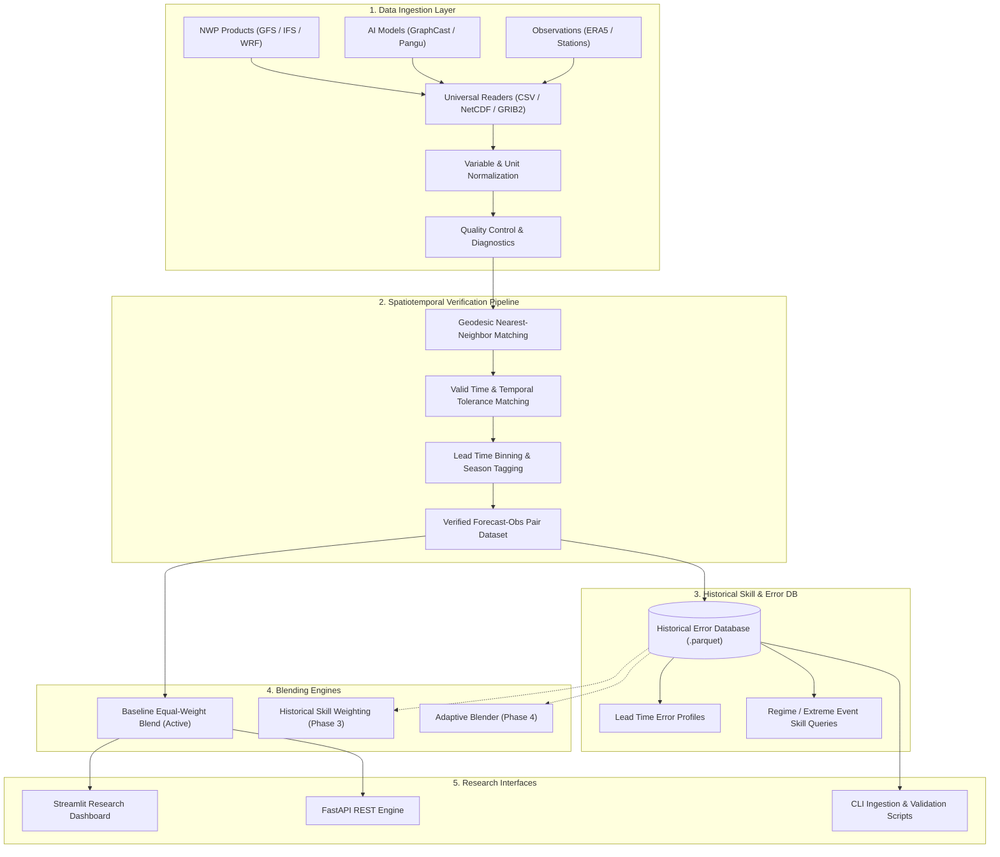

# Hybrid AI–NWP Multi-Model Forecast Blending System

[](https://www.python.org/downloads/)
[]()
[](https://pytorch.org/)
[]()

A research-oriented meteorological software framework designed to dynamically blend multi-model weather forecasts from Numerical Weather Prediction (NWP) systems, multi-member ensembles, and deep-learning neural weather models.

> **Status Notice (Phase 5 Milestone)**: This repository implements **2D Spatial Convolutional Blending and Probabilistic Post-Processing** alongside Phases 1–4. Features include 2D gridded spatial alignment (bilinear & nearest neighbor on xarray / NetCDF), a PyTorch Spatial CNN Encoder and Mixture-of-Experts Gating Network producing convex weight fields $W_m(x,y) \ge 0, \sum_m W_m(x,y) = 1$, multi-model disagreement layers ($\mu, \sigma, \text{range}, \text{pairwise}$), Gaussian Ensemble Model Output Statistics (EMOS), Continuous Ranked Probability Score (CRPS), Brier Score reliability curves, extreme event probability maps, and zero-leakage chronological benchmarking with 163 automated tests.


---

## Table of Contents

1. [Project Objective](#1-project-objective)
2. [Scientific Concept & Mathematical Foundations](#2-scientific-concept--mathematical-foundations)
3. [System Architecture](#3-system-architecture)
4. [Real Weather Data Pipeline (Phase 2)](#4-real-weather-data-pipeline-phase-2)
   - [4.1 Supported Formats & Optional Dependencies](#41-supported-formats--optional-dependencies)
   - [4.2 Standardized Meteorological Schemas](#42-standardized-meteorological-schemas)
   - [4.3 Variable Name Standardization & Mapping](#43-variable-name-standardization--mapping)
   - [4.4 Unit Normalization Layer](#44-unit-normalization-layer)
   - [4.5 Spatial Alignment (Nearest-Neighbor Matching)](#45-spatial-alignment-nearest-neighbor-matching)
   - [4.6 Temporal Alignment (Valid Time & Tolerance)](#46-temporal-alignment-valid-time--tolerance)
   - [4.7 Data Quality Control & Reporting](#47-data-quality-control--reporting)
   - [4.8 Verified Dataset & Historical Error Database](#48-verified-dataset--historical-error-database)
   - [4.9 Execution Modes (Synthetic vs Real)](#49-execution-modes-synthetic-vs-real)
   - [4.10 Scientific Validation & Temporal Leakage Prevention](#410-scientific-validation--temporal-leakage-prevention)
5. [Data Provider Adapters](#5-data-provider-adapters)
6. [Repository Structure](#6-repository-structure)
7. [Implemented vs Interface Components](#7-implemented-vs-interface-components)
8. [Installation & Setup](#8-installation--setup)
9. [Quickstart: Execution Guide](#9-quickstart-execution-guide)
10. [Command Line Interface (CLI) Tools](#10-command-line-interface-cli-tools)
11. [Automated Testing](#11-automated-testing)

---

## 1. Project Objective

Weather forecasting accuracy varies significantly across model paradigms:
* **Physics-based NWP models** (e.g., NOAA GFS, ECMWF IFS, WRF) excel at short-to-medium range dynamics and respect mass/energy conservation, but suffer from parameterization biases, topography smoothing, and high computational latency.
* **Data-driven AI/ML weather models** (e.g., GraphCast, ClimaX, Pangu-Weather, FourCastNet) achieve high computational efficiency and superior skill in capturing non-linear convective structures (such as heavy rainfall), but can exhibit spatial blurring and physical inconsistencies.
* **Ensemble Prediction Systems** (e.g., GEFS, ECMWF EPS) provide probabilistic uncertainty bounds but require significant calibration.

The **Hybrid AI–NWP Multi-Model Forecast Blending System** aims to dynamically and adaptively blend forecasts from these heterogeneous sources based on:
* **Geographic region** (e.g., coastal marine transition vs continental plains vs mountainous terrain)
* **Forecast lead time horizon** (short-range $0\text{--}24\text{h}$, medium-range $24\text{--}72\text{h}$, extended-range $>72\text{h}$)
* **Climatological season & calendar cycle** (e.g., DJF winter vs JJA summer / monsoon)
* **Synoptic weather regimes** (e.g., convective storms vs synoptic gales vs calm heat)
* **Rolling historical model skill** (variance-weighted and bias-corrected performance)

---

## 2. Scientific Concept & Mathematical Foundations

### 2.1 Baseline Equal-Weight Blend

The baseline multi-model ensemble forecast $F_{\text{blend}}(x, y, t, \tau)$ for a variable at location $(x, y)$, valid time $t$, and lead horizon $\tau$ is formulated as:

$$
F_{\text{blend}}(x, y, t, \tau) = \frac{1}{N_{\text{valid}}} \sum_{i=1}^{N_{\text{valid}}} F_i(x, y, t, \tau)
$$

where $N_{\text{valid}}$ is the number of reporting, non-null model forecasts at that spatiotemporal coordinate.

### 2.2 Phase 3 Adaptive Blending Formulations

#### 1. Inverse-Variance Skill Blending
For each member forecast model $i$, historical error variance $\sigma_i^2$ (or Mean Squared Error $\text{MSE}_i = \frac{1}{M}\sum e_i^2$) is computed over prior verified cycles. The raw weight is assigned as:

$$
w_i = \frac{1 / \left(\sigma_i^2 + \epsilon\right)}{\sum_{j=1}^N 1 / \left(\sigma_j^2 + \epsilon\right)}
$$

where $\epsilon = 10^{-6}$ ensures numerical stability.

#### 2. Inverse-MAE Skill Blending
An L1-norm robust alternative to variance weighting:

$$
w_i = \frac{1 / \left(\text{MAE}_i + \epsilon\right)}{\sum_{j=1}^N 1 / \left(\text{MAE}_j + \epsilon\right)}
$$

#### 3. Weight Regularization & Smoothing
To prevent severe over-concentration on noisy sample spikes, weights are smoothed toward the uninformative equal-weight prior ($1/N$):

$$
w_i' = (1 - \alpha) w_i + \alpha \frac{1}{N}
$$

where $\alpha = 0.10$ (configurable in `configs/config.yaml`).

#### 4. Adaptive Ridge Regression Blending
Models the linear relationship between multi-model forecasts and ground-truth observations:

$$
y = \beta_0 + \beta_1 F_1 + \beta_2 F_2 + \dots + \beta_N F_N
$$

* **Mode A (Standard Ridge):** Solves unconstrained L2 regularized regression with separate intercept $\beta_0$.
* **Mode B (Constrained Simplex):** Solves quadratic bounded optimization enforcing non-negative normalized weights:

$$
\min_{\mathbf{w}} \frac{1}{2M} \|\mathbf{y} - (\beta_0 + \mathbf{X}\mathbf{w})\|_2^2 + \frac{\alpha}{2} \|\mathbf{w}\|_2^2 \quad \text{s.t.} \quad w_i \ge 0, \quad \sum_{i=1}^N w_i = 1
$$

#### 5. Sparse Data Hierarchical Fallback
When data in a granular context has fewer than `minimum_samples` ($N < 20$), skill estimates automatically fall back through a deterministic hierarchy:

```
[Level 4] model + variable + lead_time + region
     ↓ (if N < minimum_samples)
[Level 3] model + variable + lead_time
     ↓ (if N < minimum_samples)
[Level 2] model + variable
     ↓ (if N < minimum_samples)
[Level 1] model global
```

### 2.3 Verification Metrics
Given ground-truth observations $y = \{y_1, y_2, \dots, y_M\}$ and model predictions $\hat{y} = \{\hat{y}_1, \hat{y}_2, \dots, \hat{y}_M\}$:

* **Mean Absolute Error (MAE):**
  $$\text{MAE} = \frac{1}{M} \sum_{k=1}^M \left|\hat{y}_k - y_k\right|$$

* **Root Mean Squared Error (RMSE):**
  $$\text{RMSE} = \sqrt{\frac{1}{M} \sum_{k=1}^M \left(\hat{y}_k - y_k\right)^2}$$

* **Mean Bias Error (Bias):**
  $$\text{Bias} = \frac{1}{M} \sum_{k=1}^M \left(\hat{y}_k - y_k\right)$$

* **Pearson Correlation Coefficient ($r$):**
  $$r = \frac{\sum_{k=1}^M (y_k - \bar{y})(\hat{y}_k - \bar{\hat{y}})}{\sqrt{\sum_{k=1}^M (y_k - \bar{y})^2 \sum_{k=1}^M (\hat{y}_k - \bar{\hat{y}})^2}}$$

* **Relative Skill Improvement (%):**
  $$\text{Improvement}_{\text{rel}} (\%) = \frac{\text{RMSE}_{\text{baseline}} - \text{RMSE}_{\text{blend}}}{\text{RMSE}_{\text{baseline}}} \times 100$$

---

## 3. System Architecture



---

## 4. Real Weather Data Pipeline (Phase 2)

### 4.1 Supported Formats & Optional Dependencies

The ingestion layer (`ingestion/readers.py`) supports multiple meteorological file formats:

| Format | File Extensions | Default Engine | Optional Dependencies |
| :--- | :--- | :--- | :--- |
| **CSV / TSV** | `.csv`, `.tsv`, `.txt` | `pandas` | Always enabled |
| **Parquet** | `.parquet`, `.pq` | `pyarrow` | Always enabled |
| **NetCDF** | `.nc`, `.nc4`, `.netcdf` | `xarray` / `scipy` / `netCDF4` | Enabled when `netCDF4` or `h5netcdf` installed |
| **GRIB2** | `.grib`, `.grib2`, `.grb2` | `cfgrib` / `ecCodes` | Enabled when `cfgrib` & `eccodes` installed |

If an optional format library (like `cfgrib`) is missing when attempting to decode GRIB2, the pipeline raises a clear, informative error instructing how to install the required system libraries without breaking the core system.

### 4.2 Standardized Meteorological Schemas

All external datasets are transformed into standardized Pydantic data schemas (`ingestion/schema.py`):

#### Forecast Schema (`ForecastRecord`):
```text
timestamp          : UTC verification datetime (timezone-aware)
latitude           : float in [-90.0, 90.0]
longitude          : float in [-180.0, 180.0]
lead_time          : non-negative integer (hours)
model_name         : string identifier (e.g. 'nwp_model_a', 'gfs')
variable           : standard variable ('temperature', 'rainfall', 'wind_speed')
forecast_value     : numerical prediction in standard units
run_time           : UTC cycle initialization datetime (optional)
ensemble_member    : identifier (optional)
region             : geographic domain (optional)
season             : climatological season tag (optional)
weather_regime     : synoptic regime tag (optional)
```

#### Observation Schema (`ObservationRecord`):
```text
timestamp          : UTC observation datetime (timezone-aware)
latitude           : float in [-90.0, 90.0]
longitude          : float in [-180.0, 180.0]
variable           : standard variable ('temperature', 'rainfall', 'wind_speed')
observed_value     : ground-truth observation in standard units
station_id         : station sensor tag (optional)
region             : geographic domain (optional)
elevation          : meters above sea level (optional)
quality_flag       : integer (1 = valid, 0 = flagged)
```

### 4.3 Variable Name Standardization & Mapping

Different external weather providers use varying naming conventions. The mapping layer (`ingestion/variable_mapping.py`) automatically maps aliases into standardized project variables:

* **Temperature** $\leftarrow$ `t2m`, `T2M`, `2m_temperature`, `2t`, `temp`, `tmp`, `TMP`, `t_2m`, `air_temperature`, `t_surface`
* **Rainfall** $\leftarrow$ `rainfall`, `rain`, `tp`, `TP`, `precipitation`, `precip`, `total_precipitation`, `apcp`, `APCP`, `rain_mm`, `prate`
* **Wind Speed** $\leftarrow$ `wind_speed`, `wind`, `ws10`, `WS10`, `10m_wind`, `10si`, `si10`, `wspd`, `windspeed`, `speed_10m`

### 4.4 Unit Normalization Layer

Standard internal units (`ingestion/units.py`):
* **Temperature**: Celsius ($^\circ\text{C}$)
* **Rainfall**: Millimeters ($\text{mm}$)
* **Wind Speed**: Meters per second ($\text{m/s}$)

Supported physical conversions:
* **Kelvin $\rightarrow$ Celsius**: $^\circ\text{C} = \text{K} - 273.15$
* **Fahrenheit $\rightarrow$ Celsius**: $^\circ\text{C} = (^\circ\text{F} - 32) \times \frac{5}{9}$
* **Meters $\rightarrow$ Millimeters**: $\text{mm} = \text{m} \times 1000$
* **Inches $\rightarrow$ Millimeters**: $\text{mm} = \text{in} \times 25.4$
* **$\text{kg/m}^2$ (water equivalent) $\rightarrow$ Millimeters**: $\text{mm} = \text{kg/m}^2 \times 1.0$
* **$\text{km/h} \rightarrow \text{m/s}$**: $\text{m/s} = \text{km/h} / 3.6$
* **$\text{knots} \rightarrow \text{m/s}$**: $\text{m/s} = \text{kts} \times 0.514444$
* **$\text{mph} \rightarrow \text{m/s}$**: $\text{m/s} = \text{mph} \times 0.44704$

### 4.5 Spatial Alignment (Nearest-Neighbor Matching)

Forecast grid meshes and station coordinates frequently differ. `preprocessing/spatial.py` computes Great Circle geodesic distances via the Haversine formula and matches observations to the nearest forecast point:

$$d = 2 R \arcsin\left(\sqrt{\sin^2\left(\frac{\Delta\phi}{2}\right) + \cos(\phi_1)\cos(\phi_2)\sin^2\left(\frac{\Delta\lambda}{2}\right)}\right)$$

* **Configurable threshold**: `spatial_alignment.max_distance_km = 50.0`
* Pairs exceeding this threshold are flagged and excluded from verification.
* Multi-model grids are matched independently per model.

### 4.6 Temporal Alignment (Valid Time & Tolerance)

* **Canonical verification timestamp**:
  $$\text{valid\_time} = \text{run\_time} + \text{lead\_time}$$
* **Temporal tolerance window**: `temporal_alignment.tolerance_minutes = 30`
* Observations and forecast valid times outside $\pm 30\text{ min}$ are excluded.

### 4.7 Data Quality Control & Reporting

`ingestion/quality_control.py` executes automated meteorological consistency checks:
1. **Coordinate limits**: Latitude $\in [-90, 90]$, Longitude $\in [-180, 180]$
2. **Missing value audits**: Detects NaNs/Infs without silently zeroing them.
3. **Physical range bounds**:
   - Temperature: $[-60^\circ\text{C}, +65^\circ\text{C}]$
   - Rainfall: $[0.0\text{ mm}, 600.0\text{ mm}]$ (no negative precipitation)
   - Wind Speed: $[0.0\text{ m/s}, 120.0\text{ m/s}]$ (no negative wind speed)
4. **Data Quality Report**: Outputs formatted counts of total, valid, missing, out-of-range, and mismatched records.

### 4.8 Verified Dataset & Historical Error Database

`preprocessing/matching.py` pairs valid forecasts with observations and calculates:
* `forecast_error` $= \text{forecast\_value} - \text{observed\_value}$
* `absolute_error` $= |\text{forecast\_error}|$
* `squared_error` $= (\text{forecast\_error})^2$
* `spatial_distance_km`
* `lead_time_bin`:
  - `short`: $[0, 24]\text{h}$
  - `medium`: $(24, 72]\text{h}$
  - `extended`: $(72, 120]\text{h}$
  - `long_range`: $> 120\text{h}$
* `season`: DJF (`winter`), MAM (`spring`), JJA (`summer`), SON (`autumn`)
* `weather_regime`: Classified synoptic regime tag

The `HistoricalErrorDatabase` (`evaluation/error_database.py`) persists these verified records to Parquet and enables multi-dimensional queries (e.g. RMSE by lead time, MAE by regime, extreme condition skill).

### 4.9 Execution Modes (Synthetic vs Real)

The framework operates in two distinct execution modes:
```bash
# Default mode (deterministic synthetic generator)
DATA_MODE=synthetic

# Real data mode (ingests real external datasets)
DATA_MODE=real
```
- In synthetic mode, the platform generates reproducible synthetic test series.
- In real mode, the pipeline processes real datasets and fails gracefully with an explicit explanation if files are missing. **The system never silently substitutes synthetic data when real mode is requested.**

### 4.10 Scientific Validation & Temporal Leakage Prevention

Weather forecasting is inherently non-stationary and time-dependent. To prevent temporal data leakage:
* Verification records strictly preserve chronological ordering.
* Train/test splitters (`TimeSeriesSplitter`) utilize forward-expanding or rolling chronological splits rather than random shuffling.

---

## 5. Data Provider Adapters

The adapter architecture (`ingestion/providers.py`) isolates provider-specific logic from the blending and evaluation engines:

```text
BaseForecastProvider
   ├── GFSProvider             (NOAA GFS GRIB2 / CSV)
   ├── ECMWFProvider           (ECMWF IFS Open Data)
   ├── WRFProvider             (Mesoscale WRF NetCDF)
   ├── AIProvider              (GraphCast / Pangu / FourCastNet)
   └── GenericForecastProvider (Universal file adapter)

BaseObservationProvider
   ├── ERA5Provider            (ECMWF ERA5 Reanalysis)
   ├── StationProvider         (In-situ surface stations)
   └── GenericObservationProvider
```

---

## 6. Repository Structure

```text
forecast-blending/
├── api/
│   ├── __init__.py
│   └── main.py                     # FastAPI REST service
├── configs/
│   ├── __init__.py                 # Pydantic configuration models
│   └── config.yaml                 # System & domain configuration
├── dashboard/
│   └── app.py                      # Streamlit research dashboard
├── data/
│   ├── raw/                        # Raw external weather files
│   ├── processed/                  # Processed verification datasets & error DB
│   ├── forecasts/                  # Standardized multi-model forecast archives
│   └── samples/                    # Sample lightweight real datasets for testing
├── evaluation/
│   ├── __init__.py
│   ├── error_database.py           # Historical verification error database
│   ├── metrics.py                  # MAE, RMSE, Bias, Pearson Correlation
│   ├── comparison.py               # Multi-model skill ranking engine
│   └── validation.py               # TimeSeriesSplitter (leakage prevention)
├── extremes/
│   ├── __init__.py
│   ├── rainfall.py                 # Precipitation extreme alerts
│   ├── heatwave.py                 # Heatwave hazard detection
│   └── wind.py                     # Gale/storm wind warnings
├── ingestion/
│   ├── __init__.py
│   ├── schema.py                   # Pydantic forecast & observation schemas
│   ├── variable_mapping.py         # Provider variable alias standardization
│   ├── units.py                    # Unit conversion and normalization
│   ├── quality_control.py          # QC validation and reporting
│   ├── readers.py                  # CSV, Parquet, NetCDF, GRIB2 readers
│   ├── providers.py                # NWP, AI, ERA5, Station adapter classes
│   ├── nwp.py                      # NWP forecast source base
│   ├── observations.py             # Observation source base
│   ├── ai_forecasts.py             # AI weather forecast adapter
│   └── synthetic.py                # Deterministic synthetic data generator
├── models/
│   ├── __init__.py
│   ├── base.py                     # BaseBlender abstract interface
│   └── baseline.py                 # Equal-weight multi-model blender
├── preprocessing/
│   ├── __init__.py
│   ├── alignment.py                # Spatiotemporal alignment & wide pivot
│   ├── spatial.py                  # Nearest-neighbor Haversine geodesic matching
│   ├── temporal.py                 # Valid time and tolerance matching
│   ├── matching.py                 # Forecast-observation verification engine
│   ├── cleaning.py                 # Physical bounds and record filtering
│   ├── features.py                 # Lead-time binning & seasonal calendar features
│   └── regimes.py                  # Weather regime classification interface
├── models/
│   ├── __init__.py
│   ├── base.py                     # BaseBlender abstract interface
│   ├── baseline.py                 # Equal-weight multi-model blender
│   ├── skill_weighting.py          # Inverse-Variance & Inverse-MAE blenders
│   └── adaptive_blending.py        # Ridge regression (standard & constrained simplex)
├── evaluation/
│   ├── __init__.py
│   ├── metrics.py                  # MAE, RMSE, Bias, Correlation metrics
│   ├── comparison.py               # Model benchmarking & ranking tables
│   ├── error_database.py           # HistoricalErrorDatabase query engine
│   └── walk_forward.py             # Walk-Forward validation & bootstrap CIs
├── scripts/
│   ├── generate_synthetic.py       # CLI synthetic data generator
│   ├── run_baseline_evaluation.py  # CLI multi-model skill benchmark
│   ├── validate_real_dataset.py    # CLI dataset inspection and QC report
│   ├── build_verification_dataset.py # CLI verified dataset builder
│   └── run_phase3_experiment.py    # CLI Phase 3 controlled experiment & report
├── tests/                          # 99 automated pytest unit & integration tests
├── requirements.txt
└── README.md
```

---

## 7. Implemented vs Interface Components

| Component | Status | Description |
| :--- | :--- | :--- |
| **Standardized Schemas** | **Implemented** | Strict Pydantic models for Forecast & Observation records with UTC enforcement |
| **Variable Mapping** | **Implemented** | Multi-provider alias dictionary mapping into standard variables |
| **Unit Normalization** | **Implemented** | Kelvin, Fahrenheit, meters, inches, km/h, knots, mph conversions |
| **Quality Control** | **Implemented** | Physical bounds, coordinate validation, missing audits, diagnostic reports |
| **Spatial Matching** | **Implemented** | Vectorized Haversine distance, cKDTree nearest neighbor, 50 km threshold |
| **Temporal Matching** | **Implemented** | $t_{\text{valid}} = t_{\text{run}} + \text{lead}$, $\pm 30\text{ min}$ tolerance |
| **Verified Dataset Builder** | **Implemented** | Full pipeline creating verified forecast-observation error pairs |
| **Historical Error DB** | **Implemented** | Parquet error store with queries for lead time, regime, and extreme skill |
| **Equal-Weight Blending** | **Implemented** | Baseline multi-model blending with missing-model tolerance |
| **Inverse-Variance Blending** | **Implemented** | Dynamical variance weighting ($w_i \propto 1/(\sigma_i^2+\epsilon)$) with smoothing |
| **Inverse-MAE Blending** | **Implemented** | L1 robust skill weighting ($w_i \propto 1/(\text{MAE}_i+\epsilon)$) |
| **Adaptive Ridge Regression** | **Implemented** | Standard and constrained simplex ($w \ge 0, \sum w = 1$) Ridge blenders |
| **Hierarchical Fallback** | **Implemented** | Automatic scope fallback for sparse lead-time/region combinations |
| **Walk-Forward Validation** | **Implemented** | Chronological evaluation strictly preventing future observation leakage |
| **Bootstrap Confidence Intervals** | **Implemented** | Paired resampling assessing statistical significance of skill improvements |
| **Streamlit Dashboard** | **Implemented** | Multi-tab UI with Dynamic Weights, Weight Evolution, Skill vs Lead Time |
| **FastAPI REST API** | **Implemented** | Endpoints for weights, adaptive blending, skill breakdown, and comparison |
| **Weather Regime Classifier** | *Interface / Stub* | Defined interface returning rule-based/placeholder regime tags for Phase 3 |
| **Neural Gating Networks** | *Slated for Phase 4* | Deep learning regime gating and non-linear blend weights |

---

## 8. Installation & Setup

### Prerequisites

* Python 3.11 or higher
* Git

### Setup Steps

```bash
# 1. Clone the repository
git clone https://github.com/pallavdeshmukh18/forecast-blending.git
cd forecast-blending

# 2. Create and activate a virtual environment
python -m venv .venv

# On Windows (PowerShell):
.venv\Scripts\Activate.ps1
# On Linux / macOS:
source .venv/bin/activate

# 3. Install required dependencies
pip install --upgrade pip
pip install -r requirements.txt
```

---

## 9. Quickstart: Execution Guide

### 1. Run Automated Unit Tests

```bash
python -m pytest -v
```

### 2. Validate Real / Sample Datasets (CLI)

```bash
python scripts/validate_real_dataset.py --input data/samples/sample_observations.csv
python scripts/validate_real_dataset.py --input data/samples/sample_all_forecasts.csv
```

### 3. Build Verified Forecast-Observation Dataset (CLI)

```bash
python scripts/build_verification_dataset.py \
    --forecast data/samples/sample_all_forecasts.csv \
    --observations data/samples/sample_observations.csv \
    --output data/processed/verification_dataset.parquet \
    --save-error-db
```

### 4. Execute Phase 4 Scientific Benchmark & Experiment Report

```bash
python scripts/run_phase4_experiment.py
```

### 5. Launch the Interactive Streamlit Research Dashboard

```bash
streamlit run dashboard/app.py
```

### 6. Launch the FastAPI REST Server

```bash
uvicorn api.main:app --reload --port 8000
```

---

## 5. Phase 4 — Weather Regime Detection & Neural Gating

### 5.1 Scientific Motivation: Why Weather Regimes Matter
Individual forecasting models possess differential physics and skill profiles under distinct atmospheric states:
* Under **stable / calm / clear conditions**, high-resolution physical synoptic NWP models (e.g., GFS, ECMWF) often demonstrate superior accuracy.
* Under **strong convective storms or heavy localized rainfall**, data-driven AI neural models (e.g., GraphCast) capture non-linear convective triggers more rapidly.
* Under **high-wind / synoptic gale events**, fine-mesh boundary-layer momentum parameterizations dominate.

Rather than hard-coding static heuristics, Phase 4 learns regime-conditioned routing dynamically from historical verification records:

$$
w_i = f(\text{atmospheric state}, \text{weather regime}, \text{lead time}, \text{region}, \text{historical skill})
$$

$$
F_{\text{blend}} = \sum_{i=1}^N w_i F_i
$$

### 5.2 Atmospheric Feature Pipeline (`preprocessing/weather_regimes.py`)
Extracts physically consistent, available features without fabricating unavailable state variables:
* **Continuous Atmospheric Signals:** Surface temperature, precipitation, wind speed, surface pressure, relative humidity.
* **Temporal Cycles:** Diurnal sine/cosine (24h period) and seasonal sine/cosine (365.25d annual period).
* **Atmospheric Gradients:** Step-wise temperature gradient and rolling precipitation metrics.

### 5.3 Rule-Based Weather Regimes
Provides deterministic, interpretable baseline classifications with strict priority resolution for overlapping compound events:
1. `heavy_rain`: Rainfall $\ge 50.0\text{ mm}$
2. `convective`: Rainfall $\ge 10.0\text{ mm}$
3. `high_wind`: Wind speed $\ge 15.0\text{ m/s}$
4. `hot_extreme`: Temperature $\ge 38.0^\circ\text{C}$
5. `cold_extreme`: Temperature $\le 0.0^\circ\text{C}$
6. `transition`: Rapid step delta $|\Delta T| \ge 4.0^\circ\text{C}$
7. `stable`: Standard calm baseline conditions

### 5.4 Unsupervised KMeans Clustering (`preprocessing/regime_clustering.py`)
* Standardized feature pipeline (`StandardScaler` fitted strictly on training data).
* Computes Silhouette Scores, Inertia (Elbow method), and cluster size distributions across $K \in [3, 4, 5, 6]$.
* Generates human-interpretable centroid profiles (Mean Temp, Rainfall, Wind speed per cluster).

### 5.5 Regime-Conditioned Skill Baseline (`models/regime_blending.py`)
`RegimeSkillBlender`, `RegimeInverseVarianceBlender`, and `RegimeInverseMAEBlender` compute historical skill conditioned on $(\text{regime} \times \text{variable} \times \text{lead time} \times \text{region})$ with a **6-Level Hierarchical Fallback**:
1. `Scope 5`: Model + Variable + Lead Time + Region + Regime
2. `Scope 4`: Model + Variable + Lead Time + Regime
3. `Scope 3`: Model + Variable + Lead Time + Region
4. `Scope 2`: Model + Variable + Lead Time
5. `Scope 1`: Model + Variable
6. `Scope 0`: Global Model Mean

### 5.6 Neural Mixture-of-Experts Gating (`models/gating_model.py`)
* PyTorch Feed-Forward Neural Network mapping standardized atmospheric feature vectors to routing logits.
* Final **Softmax Layer** strictly guaranteeing $w_i \ge 0$ and $\sum w_i = 1.0$.
* Trained directly against observed ground truth to minimize:

$$
\mathcal{L} = \left( y - \sum_{i=1}^N w_i F_i \right)^2
$$

* Built-in early stopping on validation loss and CPU compatibility.
* Optional learned residual head $r(x)$ (disabled by default to maintain pure forecast blending).

### 5.7 Leakage Prevention & Walk-Forward Validation
* Feature scalers, cluster centroids, and neural weights are fitted **strictly on historical training cycles** ($T < T_{\text{test}}$).
* Future observation perturbation tests verify that historical weights and cluster boundaries remain invariant.

### 5.8 Spatial Model Weight Maps & Dashboard
* Streamlit interactive tab **"🌪️ Weather Regimes & Gating"** displays geographic continuous color maps of model weights across stations.
* Visualizes cluster diagnostics, regime-stratified metric tables, and extreme precipitation guidance.

---

## 6. Spatial Convolutional Blending & Probabilistic Post-Processing (Phase 5)

Phase 5 extends the system from point/station verification to genuine **2D spatial weather fields** and **probabilistic post-processing**.

```text
NWP / AI Forecast Grids
        │
        ▼
Common Spatial Grid (GridDefinition & Aligner)
        │
        ▼
Spatial Alignment (Bilinear / Nearest)
        │
        ▼
Atmospheric Feature Fields & Multi-Model Disagreement Layer
        │
        ├───────────────┐
        ▼               ▼
Weather Regime      Historical Skill
        │               │
        └───────┬───────┘
                ▼
        Spatial CNN Encoder
                │
                ▼
       Spatial Gating Network
                │
                ▼
       Weight Field W_m(x,y)
                │
                ▼
      Multi-Model Blending
                │
                ├───────────────┐
                ▼               ▼
       Deterministic      Probabilistic
          Forecast          Forecast (EMOS)
                │               │
                ▼               ▼
          MAE/RMSE        CRPS / Brier Score
                │               │
                └───────┬───────┘
                        ▼
            Streamlit & FastAPI Suite
```

### 6.1 Standardized 2D Spatial Grid Representation
* Built on `xarray.Dataset` with coordinates `(time, lead_time, model, latitude, longitude)`.
* `preprocessing/spatial_grid.py`: `GridDefinition` and `SpatialGridAligner` supporting bilinear and nearest-neighbor interpolation, NaN masking, and spatial coverage diagnostics.
* Provider-neutral ingestion in `ingestion/grid_readers.py` (`load_forecast_grid`, `load_observation_grid`, `standardize_grid_variables`).

### 6.2 Spatial Feature Engineering & Model Disagreement Layer
* Horizontal gradients $\nabla_x, \nabla_y$, local spatial moving-window statistics ($\mu_{local}, \sigma_{local}$), and spatial anomalies.
* **Spatial Model Disagreement**: Inter-model ensemble mean $\mu(x,y)$, inter-model spread $\sigma(x,y)$, range $\max - \min$, and pairwise differences $|F_i - F_j|$.

### 6.3 Spatial CNN Encoder & Mixture-of-Experts Gating
* `models/spatial_encoder.py`: Lightweight 2D CNN encoder preserving $(H, W)$ spatial resolution with same-padding convolutions.
* `models/spatial_gating.py`: `SpatialGatingNetwork` and `SpatialCNNBlender`.
* Produces convex spatial model weight fields:

$$
W_m(x,y) \ge 0, \quad \sum_{m=1}^M W_m(x,y) = 1.0
$$

* Forecast blending:

$$
F_{\text{blend}}(x,y) = \sum_{m=1}^M W_m(x,y) F_m(x,y)
$$

### 6.4 Probabilistic Forecasting & Gaussian EMOS Calibration
* `models/probabilistic.py`: `ProbabilisticForecast`, `EnsembleProbabilisticModel`, `ResidualUncertaintyProbabilisticModel`.
* `models/emos.py`: Gaussian Ensemble Model Output Statistics:

$$
Y \sim N(\mu(x,y), \sigma^2(x,y))
$$

$$
\mu = a + b \bar{F}, \quad \sigma^2 = c + d S^2 \quad (c > 0, d \ge 0)
$$

* Evaluated via analytical Gaussian CRPS and empirical ensemble CRPS.

### 6.5 Probabilistic & Spatial Verification Metrics
* **CRPS & CRPSS**: Continuous Ranked Probability Score and skill score relative to equal-weight baseline.
* **PICP & MPIW**: Prediction Interval Coverage Probability and Mean Prediction Interval Width.
* **Reliability & Brier Score**: Brier Score $\text{BS} = \frac{1}{N}\sum (p_i - o_i)^2$, Brier Skill Score $\text{BSS}$, and reliability diagrams.
* **Spatial Metrics**: Spatial MAE, Spatial RMSE, and Spatial Weight Entropy.

---

## 7. Command Line Interface (CLI) Tools

### `scripts/run_phase5_experiment.py`
Executes complete Phase 5 benchmark across 10 forecasting models and blenders, runs the 5-experiment ablation study, evaluates CRPS and Brier score calibration, and produces `reports/phase5_spatial_probabilistic.md`:
```bash
python scripts/run_phase5_experiment.py
```

### `scripts/run_phase4_experiment.py`
Executes complete Phase 4 benchmark across all 10 candidate models/blenders, computing overall metrics, regime-stratified breakdowns, contingency tables, and bootstrap CIs:
```bash
python scripts/run_phase4_experiment.py
```

### `scripts/run_phase3_experiment.py`
Executes Phase 3 multi-model adaptive skill experiment:
```bash
python scripts/run_phase3_experiment.py
```

### `scripts/validate_real_dataset.py`
Validates any CSV, Parquet, or NetCDF file against internal schema and outputs a Data Quality Report.
```bash
python scripts/validate_real_dataset.py --input path/to/dataset.csv [--type forecast|observation]
```

### `scripts/build_verification_dataset.py`
Executes end-to-end ingestion, variable mapping, unit conversion, spatial/temporal matching, error metric calculation, and outputs the verification dataset:
```bash
python scripts/build_verification_dataset.py \
    --forecast path/to/forecasts.csv \
    --observations path/to/observations.csv \
    --output data/processed/verification_dataset.parquet \
    --max-distance 50.0 \
    --tolerance 30 \
    --save-error-db
```

---

## 8. Automated Testing

The automated test suite contains **163 automated tests** covering 100% of Phase 1, Phase 2, Phase 3, Phase 4, and Phase 5 functionality:

```bash
python -m pytest -v
```

### Coverage by Domain:
* `test_spatial_grid.py`: GridDefinition bounds, shapes, mesh creation, nearest and bilinear interpolation on regular and irregular coordinates, missing-data diagnostics.
* `test_spatial_features.py`: Horizontal gradients, moving-window local spatial statistics, spatial anomalies, inter-model disagreement layers.
* `test_spatial_blending.py`: SpatialWeightedBlender, SpatialEqualWeightBlender, SpatialInverseVarianceBlender, simplex sum-to-1 weights, weight smoothing.
* `test_spatial_encoder.py`: 2D CNN spatial encoder, $(H, W)$ spatial resolution preservation, batch and dropout evaluation.
* `test_spatial_gating.py`: SpatialGatingNetwork Softmax routing weights, SpatialCNNBlender training loop, early stopping, inference.
* `test_probabilistic.py`: ProbabilisticForecast container, CDF, exceedance probabilities, quantiles P10-P90, central 80% prediction intervals, ensemble & residual models.
* `test_emos.py`: Gaussian Ensemble Model Output Statistics (EMOS), minimum CRPS parameter estimation $(a,b,c,d)$, non-negative variance constraints.
* `test_probabilistic_metrics.py`: Continuous Ranked Probability Score (CRPS Gaussian & Ensemble), CRPSS, PICP, MPIW, Sharpness, Spatial MAE/RMSE, Spatial Weight Entropy.
* `test_calibration.py`: Brier Score, Brier Skill Score, Reliability Curve generation, sharpness distribution, event probability calibration.
* `test_spatial_leakage.py`: Future observation perturbation tests verifying spatial feature normalizers, spatial inverse-variance weights, and Spatial CNN weights remain bitwise identical.
* `test_probabilistic_leakage.py`: Future observation perturbation tests verifying EMOS parameters $(a,b,c,d)$ and residual uncertainty estimators are strictly un-snooped.
* `test_weather_regimes.py`: Feature extraction, cyclical temporal features, rule-based deterministic classification, priority resolution.
* `test_regime_clustering.py`: KMeans unsupervised classification, StandardScaler isolation, silhouette score and inertia diagnostics, centroid profiles.
* `test_regime_blending.py`: Regime-conditioned inverse-variance and inverse-MAE blenders, simplex sum-to-1 weights, 6-level hierarchical fallback.
* `test_gating_model.py`: PyTorch Neural Gating Module, Softmax routing weights, CPU training loop, early stopping, residual head toggle.
* `test_regime_leakage.py`: Temporal isolation tests verifying scalers, cluster assignments, and historical model weights are invariant to future observation perturbations.
* `test_skill_weighting.py`: Inverse-variance and Inverse-MAE weighting math, weight smoothing regularization, hierarchical fallback scopes.
* `test_adaptive_blending.py`: Ridge regression blender, standard unconstrained vs bounded simplex modes ($w \ge 0, \sum w = 1$).
* `test_walk_forward.py`: Chronological walk-forward validation safeguards, paired bootstrap confidence intervals, and relative improvement % metrics.
* `test_controlled_experiment.py`: Emergence of differential model weights across lead time horizons and precipitation variables.
* `test_schema.py`: Schema validation, Pydantic bounds, UTC enforcement.
* `test_units.py`: Kelvin/Fahrenheit, mm/meters/inches, km/h/knots/mph conversions.
* `test_variable_mapping.py`: Provider alias standardization.
* `test_quality_control.py`: Coordinate checks, physical bounds, negative rain/wind rejection, QC reporting.
* `test_spatial_alignment.py`: Haversine geodesic calculation and distance threshold rejection.
* `test_temporal_alignment.py`: Valid-time calculation and tolerance rejection.
* `test_matching.py`: Verified pair generation, error computation, missing observations/forecasts handling.
* `test_lead_time_bins.py`: Verification of boundary conditions without interval overlap.
* `test_seasons_regimes.py`: Climatological seasonal categorization and regime interface.
* `test_providers.py`: GFS, ECMWF, WRF, AI, ERA5, Station adapters and file readers.
* `test_error_database.py`: HistoricalErrorDatabase storage and multi-dimensional skill queries.
* `test_cli_and_modes.py`: CLI script execution and `DATA_MODE` environment override.
* `test_baseline.py`, `test_metrics.py`, `test_extremes.py`, `test_api.py`, `test_synthetic_data.py`: Full baseline regression and API test suites.